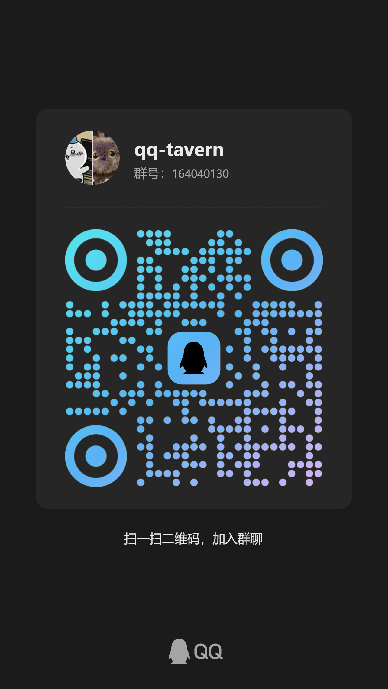
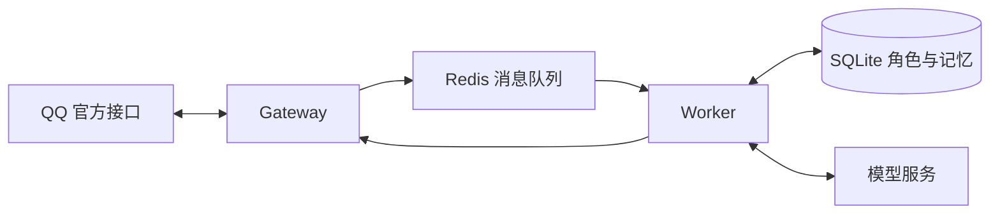

<p align="center">
  
</p>

<h1 align="center">qq-traven · qq酒馆</h1>

<p align="center">把角色、记忆与故事，带进 QQ。</p>

<p align="center">
  自行部署 · 多角色切换 · 世界书 · 独立记忆 · 好感度与状态
</p>

## 官方体验 QQ 群

**群号：164040130** · 欢迎进群体验 qq酒馆、交流角色设定和反馈问题。

<p align="center">
  <a href="docs/assets/qq-group.jpg">
    
  </a>
</p>

用手机 QQ 扫码，或搜索群号加入。点击二维码可查看原图。

---

## 在 QQ 里开一家自己的酒馆

qq-traven 是一个可自行部署的 QQ 角色扮演机器人。你可以在群聊或私聊中设定角色、编写世界书、保存记忆，让对话持续影响角色的心情和对你的好感度。

角色设置直接通过 QQ 指令完成。当前版本 **0.2.1-dev**，支持 Windows、Linux 与 macOS 上的 Docker Compose 部署。

| 能力 | 可以做什么 |
| --- | --- |
| 多角色档案 | 切换不同角色，恢复各自的人设、世界书、历史、摘要和状态 |
| 世界书 | 用常驻条目与关键词触发条目补充背景设定 |
| 长期记忆 | 分别保存群内公共记忆与当前成员的个人偏好 |
| 好感度与状态 | 按成员记录好感度和关系，共享心情；支持自定义状态项 |
| 按需查询 | 普通聊天不附加状态栏，发送指令时才显示已保存的数值 |
| 模型接入 | 支持 Responses、Chat Completions；各家配置单独提供 |
| 可选工具 | 配置后启用搜索、网页读取、图片生成／编辑和语音 |

## 开始部署

需要 **Docker Compose**、一个支持工具调用的模型接口，以及可授权的 QQ 官方机器人。Windows 请先启动 Docker Desktop，并切换到 Linux 容器。

### 1. 获取项目

```sh
git clone https://github.com/supertx/qq-tavern.git qq-traven
cd qq-traven
```

项目展示名称为 **qq-traven / qq酒馆**；仓库地址、Go 模块路径、二进制与镜像名仍沿用 `qq-tavern`，现有部署无需改名。

### 2. 选择一家模型服务并配置

公共配置与模型配置已分开。**只选择一个模型模板**，按对应文档生成本地 `.env`，填写密钥、模型名和内部通信令牌。

| 接入方式 | 独立配置文件 | 接入说明 |
| --- | --- | --- |
| OpenAI | [openai.env.example](config/models/openai.env.example) | [OpenAI 配置](config/models/openai.md) |
| 智谱 GLM | [zhipu.env.example](config/models/zhipu.env.example) | [智谱配置](config/models/zhipu.md) |
| 其他兼容接口 | [compatible.env.example](config/models/compatible.env.example) | [兼容接口配置](config/models/compatible.md) |

**[配置文件使用方法 →](config/models/README.md)** 包含 Windows PowerShell 和 Linux/macOS 的完整初始化命令。`.env.example` 只保存公共配置；已经部署的用户继续使用现有 `.env` 即可。

### 3. 连接 QQ 并启动

推荐扫码连接。在 `.env` 中将 `QQ_APP_ID`、`QQ_APP_SECRET` 留空，运行：

**Windows PowerShell / CMD**

```powershell
.\scripts\start.cmd qr
```

**Linux / macOS**

```sh
./scripts/start.sh qr
```

用手机 QQ 扫描终端二维码并完成授权，脚本会启动 Redis、Gateway 和 Worker。这里授权的是 **QQ 官方机器人**。重启运行同一命令即可复用已有绑定。

已有 AppID / AppSecret 时，将两项填入 `.env`，把启动参数 `qr` 换为 `manual`。不带参数会显示选择菜单。Windows 入口兼容 PowerShell 5.1，无需安装 Bash。

### 4. 在 QQ 里试一试

群里先 **@机器人**，再发送命令；私聊直接发送。以下命令逐条执行：

```text
/酒馆
/当前模型
/角色 名称 丛雨
/角色 描述 守护神刀的少女，与来访者在神社相遇
/角色 性格 嘴上逞强，心地善良，说话带一点古风
/角色 场景 午后的神社，风吹过廊下的风铃
```

然后像平常一样聊天。人设内容可以随时调整；更多设置见 [QQ 命令说明](docs/COMMANDS.md)。

## 让角色记住你

每个角色保存自己的世界书、聊天历史、摘要和记忆。群内切换角色对全群生效；不同群、私聊及不同角色之间的数据相互隔离。

```text
/角色 列表
/角色 新建 芳乃
/角色 切换 丛雨
/角色状态
/好感度 丛雨
/状态记录
```

默认好感度为 **20**，范围 **0～100**，每轮最多增减 **3**。好感度和关系按成员分别保存，心情由角色共享。模型根据实际互动按需更新，回复确认发送成功后才保存；查询直接读取数据库。

想增加信任度、体力或当前位置，也可以自己定义：

```text
/状态项 添加 信任度 数值 成员
/状态项 设置 信任度 初始值 10
/状态项 设置 信任度 规则 遵守承诺时增加，欺骗时降低
/状态项 添加 当前地点 文本 角色
/状态设置 当前地点 神社
```

状态变化依赖模型判断，细微变化可能不会记录。可以用 `/状态设置 好感度 30` 手动校正。`/重置上下文` 保留角色状态与长期记忆。

## 文档导航

| 想了解什么 | 从这里看 |
| --- | --- |
| 角色、世界书、记忆和状态怎么设置 | [QQ 命令说明](docs/COMMANDS.md) |
| 如何填写模型配置 | [模型配置目录](config/models/README.md) |
| 公共参数、可选工具和运行边界 | [配置参考](docs/CONFIGURATION.md) |
| 查看日志、更换机器人、备份与升级 | [部署与维护](docs/DEPLOYMENT.md) |
| 本地开发、自动化测试与发布检查 | [开发与验证](docs/DEVELOPMENT.md) |
| 版本更新 | [变更日志](CHANGELOG.md) |

## 工作方式



一套部署连接一个机器人，可服务多个群。Gateway 负责 QQ 连接，Worker 负责模型对话与角色数据，SQLite 保存配置和历史。

本项目独立实现酒馆式角色与记忆机制，不依赖 SillyTavern 服务。目前不包含角色卡导入、第三方酒馆插件、向量检索、定时任务和主动互动。群成员均可修改群公共设置；群内查询也会回复到该群。

## 许可与来源

项目新增代码使用 [MIT 许可证](LICENSE)。第三方依赖保留各自许可，详见 [第三方声明](THIRD_PARTY_NOTICES.md) 和 [来源清单](docs/PROVENANCE.md)。图像素材说明见 [品牌素材](docs/assets/README.md)。
