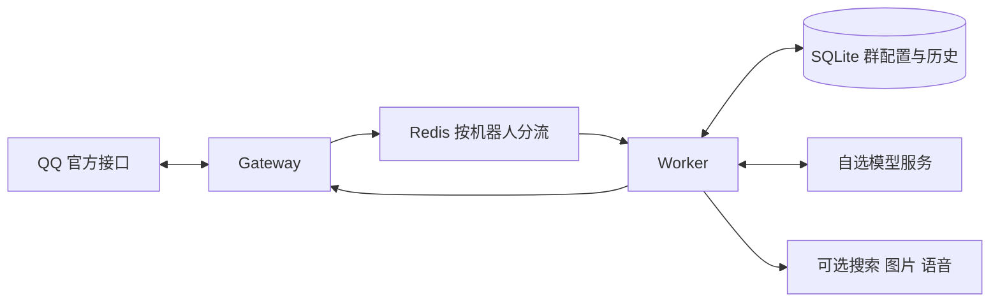

# qq-tavern

可自行部署的 QQ 机器人：角色、世界书、群规则、摘要和个人记忆均按会话隔离，直接在 QQ 内设置。当前版本为 `0.2.1-dev`，私有开发阶段；尚未进行真实 QQ 账号验收。

## 快速启动

准备 Docker Compose 和支持 Responses 或 Chat Completions 的模型接口。QQ 连接有两种方式：**手机 QQ 扫码授权机器人**，或手动填写 AppID/AppSecret。扫码连接的是 QQ 官方机器人，不是登录个人 QQ 账号。

```sh
git clone https://github.com/supertx/qq-tavern.git
cd qq-tavern
cp .env.example .env
openssl rand -hex 32
```

将生成的随机串填入 `.env` 的 `INTERNAL_API_TOKEN`，填写 `MODEL_BASE_URL`、`MODEL_API_KEY` 和 `MODEL_NAME`。模型服务需要支持所选协议、工具调用和配置的思考强度。默认使用 Responses、`medium`；Chat Completions 使用 `MODEL_API_MODE=chat_completions`。不会在请求失败时自动切换协议。

### 方式一：扫码连接

`.env` 的 `QQ_APP_ID`、`QQ_APP_SECRET` 留空，然后在可显示二维码的终端运行：

```sh
./scripts/start.sh qr
```

启动脚本先运行一次性登录容器，在终端显示二维码。用手机 QQ 扫码并按页面完成机器人授权；成功后自动启动 Redis、Gateway、Worker。QQ 账号需要具备对应的机器人管理／授权资格，具体以 QQ 扫码页面为准。五分钟内未完成则退出，可重新运行。重启执行同一命令，默认复用保存的绑定，无需再次扫码。

### 方式二：手动配置

在 `.env` 再填写 `QQ_APP_ID` 和 `QQ_APP_SECRET`，然后运行：

```sh
./scripts/start.sh manual
```

直接运行 `./scripts/start.sh` 会显示两种方式的选择菜单。两种方式均在启动服务前检查配置；手动方式也兼容原有的 `docker compose up -d --build`。

查看扫码部署状态和日志时带上扫码覆盖文件；手动部署省略第二个 `-f`：

```sh
docker compose -f compose.yaml -f compose.qr.yaml ps
docker compose -f compose.yaml -f compose.qr.yaml logs --tail=100 gateway worker
```

Gateway 健康检查要求 QQ 已连接。连接失败时 Worker 会等待；检查机器人凭据、QQ 平台权限、IP 白名单和网络。接收所有群消息需另获 QQ 权限，再设置 `QQ_OBSERVE_GROUP_MESSAGES=true`；默认只处理机器人收到的群 @ 和私聊事件。

群里 @机器人并发送：

```text
/酒馆
/当前模型
/群规则 设置 回复简洁，使用中文
记住，我们每周五晚上八点讨论项目
/群记忆
```

完整语法、世界书关键词与个人记忆操作见 [QQ 命令说明](docs/COMMANDS.md)。

## 架构和数据



每套 Compose 对应一个机器人，支持多个群。Gateway 保管 QQ Secret，Worker 保管模型密钥；两者使用相同 AppID 推导队列标识。没有订单、套餐、订阅或节点控制服务依赖。

- **角色**：名称、描述、性格和场景，每群独立。
- **世界书**：长期事实，常驻或中文关键词触发，支持启停、优先级和字符预算。
- **群规则**：群内回复习惯和作者注释，默认每轮注入。
- **摘要**：每 3 个已完成回复轮次或空闲 2 分钟后生成，由后台每 15 秒检查。失败保留旧摘要，2 分钟后再尝试。
- **个人记忆**：只加载当前成员在当前群的内容；私聊使用独立作用域。

明确说“记住……”才保存长期内容。群内默认公共；“回复我时／我的偏好”进入个人记忆；“以后每次回复……”进入群规则。普通聊天不会自动抽取长期事实。自然语言入口使用明确前缀匹配，复杂表达请使用命令。

所有群成员可修改当前群公共设置并查看修改记录；个人记忆与个人修改记录仅本人可访问。配置采用版本检查和原子保存，每轮使用启动时的快照。昵称不作为身份；当前消息、引用和摘要保留稳定成员标识。修改角色不会删除历史，`/重置上下文` 与删除记忆是分开的操作。

会话配置与历史存放在项目隔离的数据卷中；不会读取其他机器人或旧项目的数据。上下文裁剪以完整工具轮次为单位，Responses 加密推理仅在同模型回放，QQ 回复不包含内部推理。

## 可选功能和边界

在 `.env` 填全对应配置后才启用搜索、生图／编辑、语音工具。图片与语音使用 OpenAI 兼容协议；搜索使用开启 JSON 输出的 SearXNG。网页读取只访问公开 HTTP(S)，拒绝本地网络和保留地址；遇到 403 会返回明确失败，不绕过网站限制，同轮相同请求不重试。

- 单次模型调用最长 180 秒，最多 32768 输出 token；该预算包含推理 token。
- 所有模型与工具共享本轮期限，285 秒内处理并预留发送时间。图片生成使用剩余时间，没有单独的 45 秒限制。
- 每轮最多 12 次模型调用、24 次工具执行；搜索最多 3 次，网页读取最多 6 次，生图／编辑／语音各最多 1 次。
- 文本按 1800 字分段。QQ 群消息最多 5 次被动回复，私聊最多 4 次；媒体也占一次。超长文本末尾会标记截断。
- 当前二进制媒体上限 **5 MiB**，大于上限会明确失败；尚未实现大文件分片上传。
- 发送前持久化去重记录。崩溃或网络中断导致发送结果不确定时，不自动重发，因此极端情况下可能少回复一次。
- 首版不包含角色卡导入、向量检索、第三方酒馆插件、动态 Skill 编辑、定时任务或主动互动。

`REASONING_EFFORT` 可设 `none/minimal/low/medium/high/xhigh/max`，具体能否使用取决于模型服务。`/当前模型` 显示配置；服务端拒绝不支持的档位时会返回调用失败，不宣称已使用。摘要默认 `medium`，可通过 `SUMMARY_REASONING_EFFORT` 单独设置；`SUMMARY_MODEL` 留空时沿用聊天模型。汇总日志中 `reasoning_tokens_subset` 是 `output_tokens` 的子集，不再次相加。

### 智谱 GLM 配置

[智谱官方对话接口](https://docs.bigmodel.cn/api-reference/模型-api/对话补全)使用 `/api/paas/v4/chat/completions`。直连智谱时，不能沿用 OpenAI 的 `/v1` 和 Responses 配置。GLM-5.3 与 GLM-5.3-Flash 的思考档位支持 `low/high/max`，聊天和摘要都需选择支持的档位：

```dotenv
MODEL_BASE_URL=https://open.bigmodel.cn/api/paas/v4
MODEL_API_MODE=chat_completions
MODEL_NAME=glm-5.3-flash
REASONING_EFFORT=high
SUMMARY_MODEL=glm-5.3
SUMMARY_REASONING_EFFORT=high
```

仅本地配置中的 `MODEL_API_KEY` 填入你的智谱密钥。修改配置后需重建 Worker 容器环境，单独 `docker compose restart` 不会加载新的 `.env`。扫码模式可运行 `docker compose -f compose.yaml -f compose.qr.yaml up -d --no-deps worker`；更新了应用代码时先构建新镜像。

失败日志记录 `error_kind`、`http_status`、模型、协议和档位，不输出 API Key、聊天内容或上游响应正文。常见情况：`http_status=401/403` 检查鉴权／权限，`404/405` 检查地址和协议，`400` 检查模型和参数；`error_kind=transport` 才表示传输错误。

## 运维和开发

默认健康检查端口仅绑定本机：Gateway `18700`、Worker `18710`。用不同 Compose 项目名和端口可部署多套，数据卷没有固定全局名称。不要让两套 Gateway 使用同一真实机器人并发接收事件。

扫码模式将凭据保存在项目独立的 `qq-private` 卷，文件权限为 `0600`；Gateway 只读挂载完整凭据，Worker 只读挂载 `qq-public` 卷中的 AppID。二维码只显示在前台终端，登录容器关闭 Docker 日志记录。不要分享二维码、凭据卷或 `.env`。

需要更换机器人时运行 `./scripts/start.sh qr --rebind`。脚本会先停止 Gateway 和 Worker；取消扫码或授权失败不会覆盖原绑定。失败后运行 `./scripts/start.sh qr` 可用原绑定恢复服务。身份变更后使用新的机器人作用域，旧历史仍保留在原作用域。不要同时运行两个启动脚本。

若登录容器被强制杀死，重试时可能提示登录锁已存在。先用下面第一条命令确认没有仍在运行的 `qq-login` 容器，再执行第二条清理锁并重试。仅删除锁，不删除绑定或历史卷：

```sh
docker compose -f compose.yaml -f compose.qr.yaml --profile setup ps -a
docker compose -f compose.yaml -f compose.qr.yaml run --rm --no-deps --entrypoint node qq-login -e 'require("node:fs").rmSync("/binding/private/.login-lock", {recursive:true,force:true})'
./scripts/start.sh qr
```

扫码部署执行 Compose 启停、升级和重建时始终使用 `-f compose.yaml -f compose.qr.yaml`；漏掉覆盖文件会改回手动凭据模式。切回手动模式前填写 `.env` 的 QQ 凭据，再执行 `./scripts/start.sh manual`。

备份前停止该项目服务，再备份三个业务数据卷；扫码模式额外备份两个绑定卷。SQLite 文件可能含 WAL，需要整体保留。恢复时使用对应版本镜像。数据库会拒绝高于支持版本的迁移号；升级前备份，不能用旧程序直接读新数据库。

开发需要 Go 1.23+；CI 和容器使用 Go 1.27。安装 `redis-server` 可执行文件以运行完整集成测试：

```sh
go test -race -count=1 -timeout=180s ./...
go vet ./...
go build ./cmd/qq-tavern
npm --prefix onboard ci --ignore-scripts
npm --prefix onboard test
python3 scripts/start_test.py
```

测试使用临时 SQLite、临时 Redis、模拟 QQ HTTP/WebSocket 和模拟模型服务，不需要真实账号或模型费用。扫码辅助工具的开发测试另需 Node.js 22+。CI 安装 Redis、测试两种启动方式并构建应用和登录容器。构建两个镜像后，可运行 `python3 scripts/test_login_docker.py` 验证真实容器的权限和凭据交接；该测试只使用合成凭据，容器禁用网络。环境变量检查可执行 `ROLE=worker qq-tavern check` 或 `ROLE=gateway qq-tavern check`。

发布前需更新 [VERSION](VERSION)、[变更日志](CHANGELOG.md)，执行测试、容器构建和来源／凭据检查。当前已验证扫码会话创建和模拟凭据落盘；完整手机扫码授权与真实 QQ 收发仍待独立测试机器人验收。真实 QQ 接入验收完成后再发布稳定版本；当前仓库保持私有。

## 来源与许可

本项目新增代码使用 [MIT](LICENSE)。QQ、Redis、OpenAI 协议适配及酒馆记忆机制独立编写；`company_bot@a7f0100` 仅作为行为参考，未导入其代码、Git 历史、配置、部署记录或用户数据。没有复制 SillyTavern 源码，也不依赖 SillyTavern 服务。

第三方依赖保留其原许可证；Docker 中的 Redis 服务也适用自身许可。详见 [来源清单](docs/PROVENANCE.md) 和 [第三方声明](THIRD_PARTY_NOTICES.md)。
